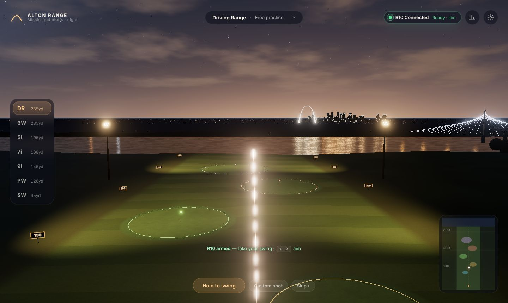
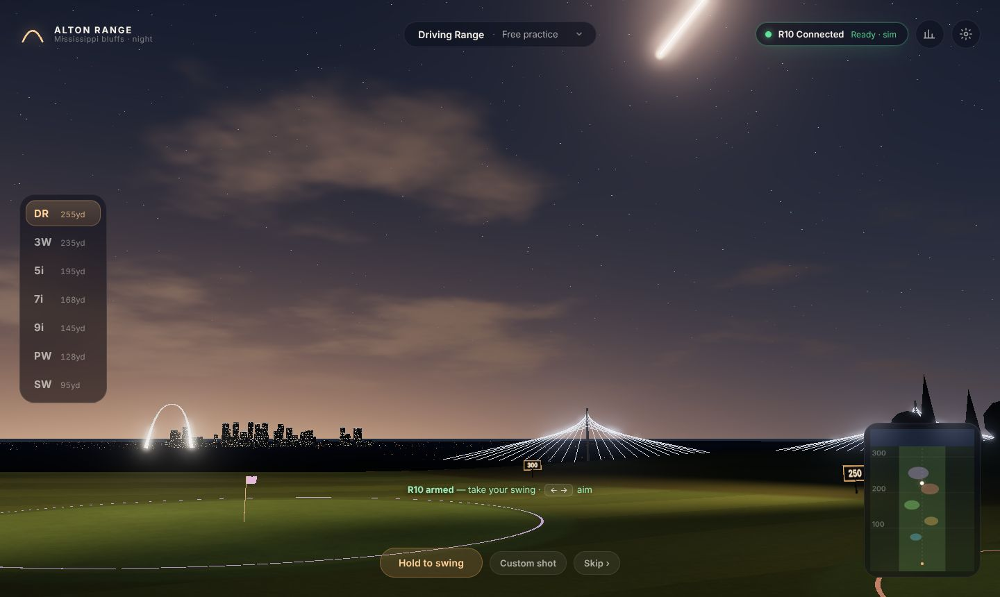
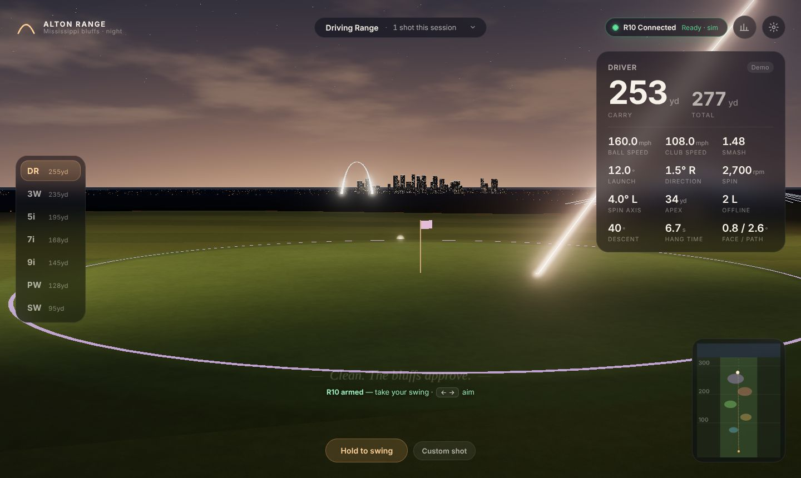
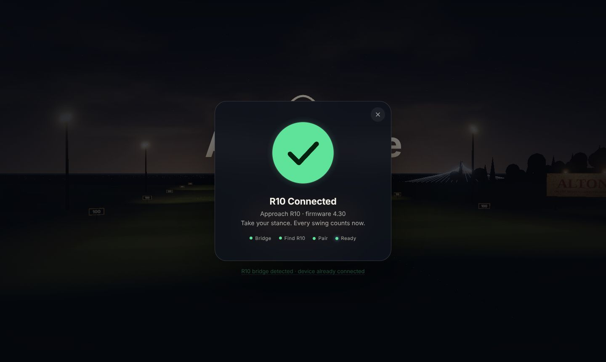
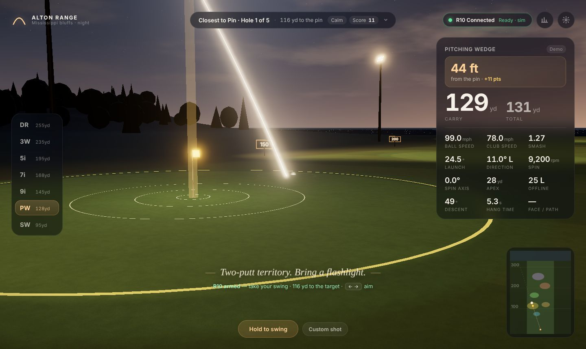

# Alton Range

A night driving range on the bluffs above the Mississippi, in the browser.
The Gateway Arch glows on the horizon, barges work the river below, and every
swing from a **Garmin Approach R10** lands live with a glowing tracer, a
cinematic camera and the full set of numbers.



| | |
|---|---|
|  |  |
|  |  |

## Quick start

**With the R10 (or to try the pairing flow):**

```bash
cd bridge
pip install -r requirements.txt
python -m r10bridge --open          # serves the game at http://localhost:8765
```

Then press **Pair Garmin R10**. No R10 handy? Run `python -m r10bridge --mock --open`
for a simulated R10 that goes through the full Bluetooth protocol stack.

**Demo mode only (no Python needed):** serve the folder with any static server
and open it in a browser. ES modules don't load from `file://`.

```bash
python -m http.server 8000          # then open http://localhost:8000
# or: npx serve .
```

Requires a WebGL 2 browser: current Chrome, Edge, Safari or Firefox.

## Running the bridge alongside the game

Browsers can't talk to the R10 directly, so a small Python bridge does it:

```
 Garmin R10 ──BLE──▶ r10bridge (Python, bleak) ──WebSocket JSON──▶ game (browser)
                     ws://localhost:8765            same port serves the game over HTTP
```

1. **Install once:** `cd bridge && pip install -r requirements.txt` (Python 3.10+).
2. **Start it:** `python -m r10bridge`. Leave the terminal open while you play.
3. **Pairing mode:** turn the R10 on and hold its button until the LED is
   **solid blue**. Close the Garmin Golf app; the R10 talks to one device at a time.
4. **Open the game** at <http://localhost:8765> and press **Pair Garmin R10**.
   You'll see the scan, then pairing, then the radar arming, then a check.
   The **R10 Connected** pill stays top-right and shows the radar state
   (Ready / Recording / Processing).
5. **Place the R10** 1.8–2.4 m (6–8 ft) behind the ball, level, with the red
   alignment line on your target (Garmin's guidance). You can set the exact
   distance in *Settings → R10 to ball*.

If the bridge isn't running, the game says so and shows the commands to copy.
If the R10 isn't found or pairing fails, you get specific fixes, plus a way
straight into demo mode. If the link drops mid-session, the bridge reconnects
on its own and the game keeps playing in demo mode until it's back.

OS notes, CLI options and the WebSocket message format are in
[`bridge/README.md`](bridge/README.md).

## Playing

| Input | Action |
|---|---|
| **Hold Space / hold the Swing button** | Demo swing: release in the green zone (84–98%) for a pure strike; soft swings stay clean, over-swings get wild |
| **← →** | Aim (also rotates R10 shots, like any simulator's target line) |
| **1–7** or **↑ ↓** | Club |
| **Enter** / double-click | Skip to the result |
| **C** | Camera: Cinematic → Follow → Tee |
| **M** | Choose a game |
| **Tab** | Session stats and personal bests |
| **Custom shot** | Type in launch numbers from any monitor |

### Games

- **Driving Range.** Free practice with ghost tracers of your last six shots,
  a dispersion mini-map and five lit target greens.
- **Closest to Pin** (featured). Five holes at varied distances (wedges, mixed
  or long), wind per hole, a pin marker in view, and proximity scoring
  (100 points × e^(−metres/6); 250 for an ace). In demo mode the prompt shows
  the swing % your club needs for the hole.
- **Target Practice.** Three targets, three balls each, scored by where the
  ball lands: bullseye 50, inner 30, on target 15, near miss 5.
- **Longest Drive.** Six balls into a 50-yard grid, with the best ball counting.
  The bluff edge sits at about 330 yards, so a big enough drive will find the
  Mississippi.

Personal bests (longest drive, top ball speed, carry by club, closest to pin,
best rounds) persist in the browser. Sessions export to CSV.

## Ball physics

Ball flight is integrated with RK4 at 240 Hz: gravity, drag and Magnus lift
driven by the spin factor *S = rω/v*, spin decay, a drag rise at low Reynolds
number, and wind. Coefficients were fitted to Trackman's published PGA Tour
averages (`node tools/calibrate.mjs` prints the check):

| Club | Ball / launch / spin | Model carry | Tour carry |
|---|---|---|---|
| Driver | 171 mph · 10.4° · 2545 rpm | 271 yd | 282 yd |
| 7-iron | 123 mph · 16.3° · 7124 rpm | 178 yd | 176 yd |
| PW | 102 mph · 24.2° · 9304 rpm | 134 yd | 136 yd |

Every club is within 4% on carry and close on apex and descent angle.
Landing uses spin-aware bounce (wedges check up, drivers release about 20 yd)
and surface-specific roll on fairway, rough and green. A ball can run off the
bluff and fall into the river. The whole flight is simulated the moment a shot
arrives, so the camera and commentary know the outcome before the ball lands.

## Project layout

```
index.html, css/app.css      UI shell and styling (no build step)
js/main.js                   boot + frame loop
js/core/                     physics, units, event bus
js/scene/                    renderer, sky, terrain, river shader, skyline (Arch, bridge,
                             barges, riverboat), range props, ball, tracer, effects, camera,
                             asset slots (glTF / characters)
js/game/                     game controller, modes, commentary
js/net/bridgeClient.js       WebSocket client for the bridge
js/ui/                       pairing flow, HUD, panels
js/audio/audio.js            procedural WebAudio sound (impacts, flight, splash, ambience, UI)
js/data/                     clubs, session store, personal bests
bridge/                      Python R10 bridge (port of 10over) + tests
vendor/three/                three.js r186, vendored so the game works offline
tools/calibrate.mjs          physics calibration check
```

## Adding Blender / glTF assets and scanned characters

`js/scene/assets.js` holds an `ASSET_MANIFEST` with a slot for each element
that might later be authored: `golfer`, `arch`, `bridge`, `riverboat`, `canopy`
and `sign`. A slot with `url: null` keeps the procedural version. Point a slot
at a `.glb` (exported from Blender at metre scale, +Y up, origin at the base)
and it loads with the transform in the manifest.

The `golfer` slot takes a rigged, scanned character. Include an animation clip
named `swing` (and optionally `idle`). Launch data arrives just after impact,
so on every shot the game plays the clip from its impact point
(`IMPACT_FRACTION` in `assets.js`) through the follow-through. Put models under
`assets/` and they're served by the bridge and by any static server.

The scene modules are split by feature (`skyline.js`, `rangeProps.js`, …), so
swapping a procedural group for an imported one stays local to one file.

## Tests

```bash
cd bridge && python -m pytest       # protocol, handshake, WebSocket, static serving
node tools/calibrate.mjs            # physics vs Trackman tour averages
```

## Credits

- R10 protocol: [divotmaker/10over](https://github.com/divotmaker/10over) (MIT OR Apache-2.0); this repo's bridge is a Python port.
- 3D: [three.js](https://threejs.org) (MIT), vendored in `vendor/three`.
- Gateway Arch geometry: the National Park Service catenary formula.
- Reference numbers: Trackman PGA Tour averages; Garmin Approach R10 Quick Start Manual (placement and pairing).

Not affiliated with Garmin, Trackman, the National Park Service or the City of Alton.
