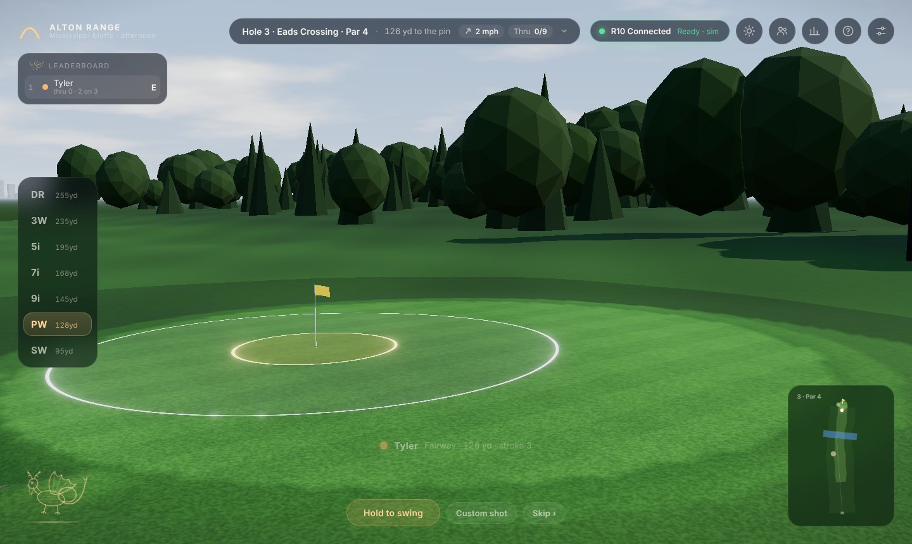
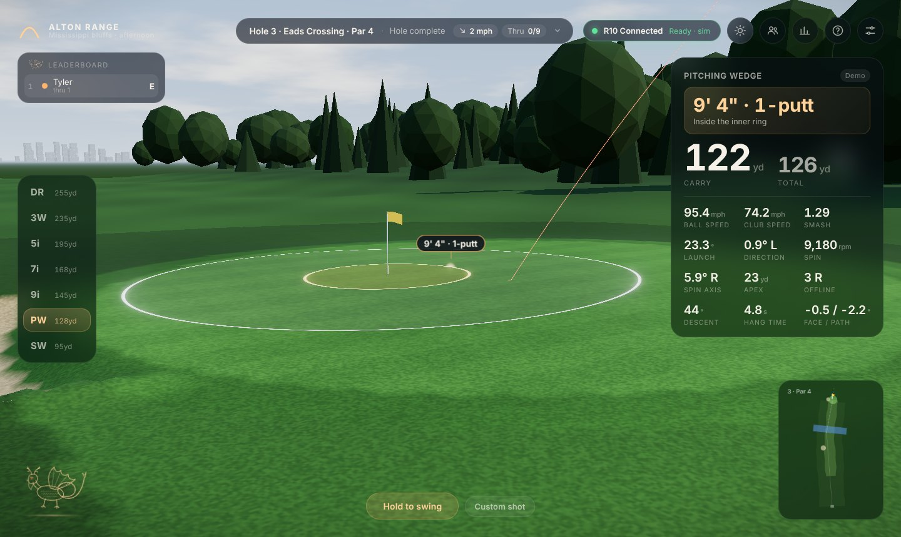
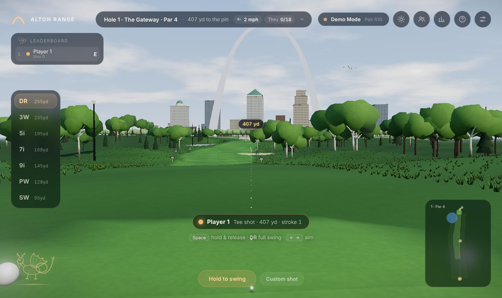
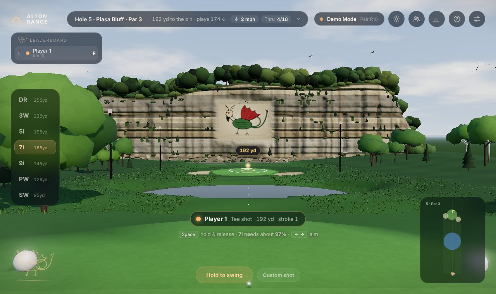
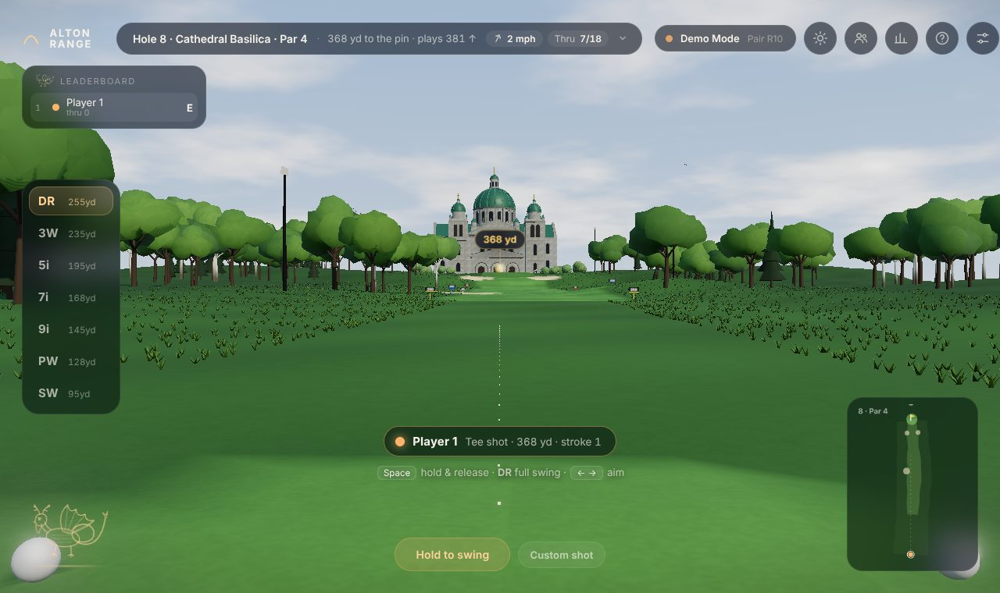
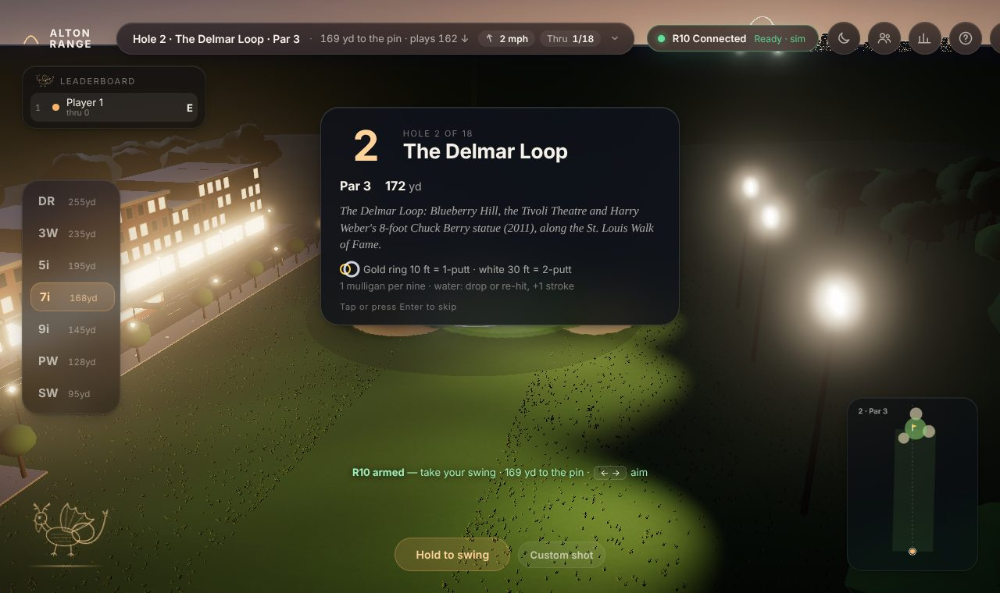
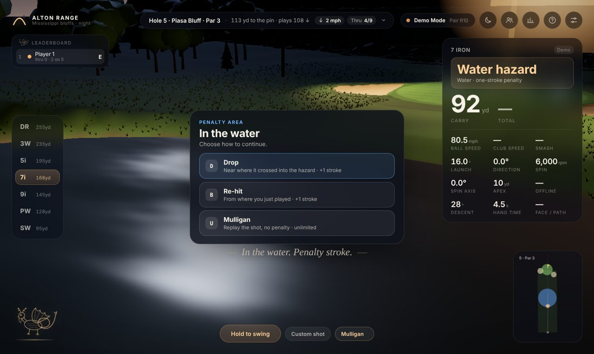
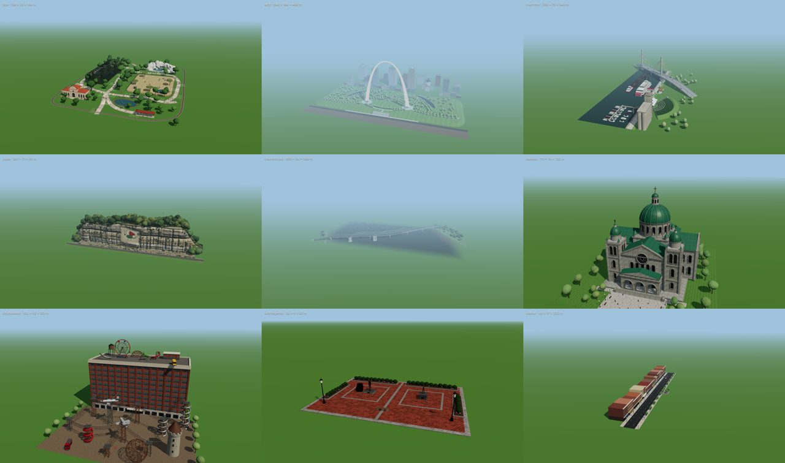
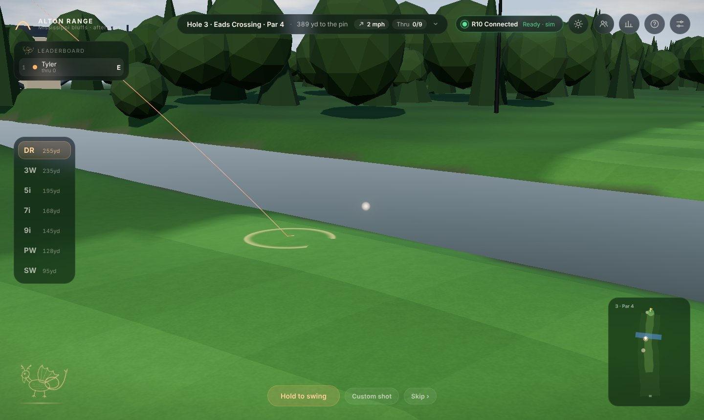

# Fairway

A golf simulator on real ground, in the browser. A night (or afternoon)
driving range on the bluffs above the Mississippi, the 18-hole Confluence
Course through St. Louis and Alton, and five nine-hole courses built on real
elevation: the Oregon Trail at Scotts Bluff, the East St. Louis riverfront,
the Bois de Boulogne in Paris, the vineyards of Cassis, and Liberty National
beside the Statue of Liberty, imported from OpenStreetMap. Up to six players
with teams, a visible club that strikes the ball, an in-game radio, and every
swing from a **Garmin Approach R10** landing live with a glowing tracer, a
cinematic camera and the full set of numbers.


| | |
|---|---|
|  |  |
|  |  |
|  |  |
|  |  |
|  |  |
|  |  |
|  |  |
|  |  |

## Quick start

**On a Mac: double-click Fairway on the Desktop.** It finds Python, sets up the
bridge, starts it and opens the game. First time, build the Desktop icon with
`launcher/install-mac.sh`. Updates, Wi-Fi play with friends and troubleshooting
are in **[PLAY.md](PLAY.md)**.

**Anywhere else (Python 3.10+; on a Mac, `launcher/fairway.sh` takes the same
`--lan` and `--mock` flags):**

```bash
cd bridge
python3 -m pip install -r requirements.txt   # first time only
python3 -m r10bridge --open                  # serves the game at http://localhost:8765
```

Then press **Pair Garmin R10**, or **Play in Demo Mode**. No R10 handy?
`python3 -m r10bridge --mock --open` runs a simulated R10 through the full
Bluetooth protocol stack.

| You want | Run on the computer | Open |
|---|---|---|
| Play on this computer | `python3 -m r10bridge` | `http://localhost:8765` |
| Play on a TV or projector from the computer | `python3 -m r10bridge` | `http://localhost:8765/?tv` |
| Use an iPad as the screen | `python3 -m r10bridge --lan` | `http://<computer-name>.local:8765/?tv` on the iPad (the bridge prints the exact address) |
| Check the Bluetooth setup step by step | `python3 -m r10bridge --diagnose` | — |
| Rehearse without hardware | `python3 -m r10bridge --mock` | `http://localhost:8765` |

**Demo mode only (no Python needed):** serve the folder with any static server.
ES modules don't load from `file://`.

```bash
python -m http.server 8000          # then open http://localhost:8000
```

Requires a WebGL 2 browser: current Chrome, Edge, Safari or Firefox.

To open a course hole directly in demo mode (handy on a kiosk or for
testing): `http://localhost:8765/?play=paris&hole=9&day`. Course ids:
`confluence`, `eaststl`, `oregon`, `paris`, `cassis`, `liberty`.

## Running the bridge alongside the game

Browsers can't talk to the R10 directly, so a small Python bridge does it:

```
 Garmin R10 ──BLE──▶ r10bridge (Python, bleak) ──WebSocket JSON──▶ game (browser)
                     ws://localhost:8765            same port serves the game over HTTP
```

1. **Install once:** `cd bridge && pip install -r requirements.txt` (Python 3.10+).
2. **Start it:** `python3 -m r10bridge`. Leave the terminal open while you play.
3. **Pairing mode:** turn the R10 on and hold its button until the LED is
   **solid blue**. Close the Garmin Golf app; the R10 talks to one device at a time.
4. **Open the game** at <http://localhost:8765> and press **Pair Garmin R10**.
   You'll see the scan, then pairing, then the radar arming, then a check.
   The **R10 Connected** pill stays top-right and shows the radar state
   (Ready / Recording / Processing).
5. **Place the R10** 1.8–2.4 m (6–8 ft) behind the ball, level, with the red
   alignment line on your target (Garmin's guidance). You can set the exact
   distance in *Settings → R10 to ball*.

If the bridge isn't running, the game says so and shows the commands to copy.
If the R10 isn't found or pairing fails, you get specific fixes, plus a way
straight into demo mode. If the link drops mid-session, the bridge reconnects
on its own and the game keeps playing in demo mode until it's back.

Press **?** (or the help button, top right) in the game at any time for the
**R10 help** panel. It shows live bridge status (heartbeat, radar state, shot
count), has **Re-arm radar**, **Reconnect** and **Test bridge** buttons, and
walks through pairing, troubleshooting ("shots don't register", "no R10
found", macOS/iPad issues) and TV setup. It's written to follow on an iPad or
a MacBook.

**Reliability.** The bridge retries transient Bluetooth errors, re-sends the
handshake if the R10 is slow to arm, reconnects without limit if the link
drops, re-arms the radar when it falls into standby, and sends a heartbeat
every 5 seconds. The game treats a silent bridge (a sleeping laptop) as lost
and reconnects. Shots are de-duplicated by the R10's shot ID, and a swing the
radar saw without the ball shows a "check alignment" toast instead of
vanishing. A rotating log goes to `~/.r10bridge/bridge.log`.

On a Mac that might sleep mid-round: `caffeinate -dims python -m r10bridge`.

OS notes, CLI options and the WebSocket message format are in
[`bridge/README.md`](bridge/README.md).

## Big screen: TV, projector, iPad

TV mode scales the whole interface for couch distance (3–4 m) and thickens
the tracer and ball. Turn it on with `?tv` in the address or *Settings → Screen*.

- **MacBook → TV (recommended).** Connect HDMI / USB-C, or AirPlay
  (*Control Center → Screen Mirroring*). Use the TV as a separate display so
  the terminal stays on the laptop. Run `python3 -m r10bridge`, open
  `http://localhost:8765/?tv` on the TV display, and go full screen (⌃⌘F).
- **iPad → TV.** iPadOS can't run the bridge, so run it on a Mac or PC with
  `python3 -m r10bridge --lan`. It prints the address to open on the iPad, e.g.
  `http://your-mac.local:8765/?tv`. In Safari use *Share → Add to Home Screen*
  for a full-screen app, then mirror the iPad to an Apple TV or through a
  USB-C / Lightning HDMI adapter. The game keeps the screen awake while you play.
- **Projector.** Same as the MacBook setup. Afternoon conditions read better
  in a bright room; turn the lights down for the night range.

`--lan` lets other devices on your network open the game and connect to the
bridge. Use it on your home Wi-Fi, not on a network you don't trust.

## Playing

| Input | Action |
|---|---|
| **Swing with the R10** | Every swing is a shot for whoever's turn it is |
| **Hold Space / hold the Swing button** | Demo swing: release in the green zone (84–98%) for a pure strike; soft swings stay clean, over-swings get wild |
| **← →** | Aim (also rotates R10 shots, like any simulator's target line); finer on the green; **R** resets |
| **1–7** or **↑ ↓** | Club (the course picks one for you each shot) |
| **Enter** | Skip to the result |
| **M** / **P** / **S** | Choose a game / players & teams / scorecard |
| **N** | Day ↔ night |
| **C** | Camera: Cinematic → Follow → Tee |
| **U** | Mulligan (course, when the rule allows) |
| **D** / **B** | After a ball in the water: drop, or re-hit from the previous spot |
| **O** | Radio on / off (the radio button picks the station) |
| **Tab** | Session stats and personal bests |
| **H** or **?** | R10 help |
| **Custom shot** | Type in launch numbers from any monitor |

### Courses

Pick a course in **Play a course** (M → Course). Every course but the
Confluence is built on real elevation baked from USGS and EU-DEM data, with a
backdrop of the real land out to the horizon and its landmarks at their true
positions:

| Course | Where | Holes | Character |
|---|---|---|---|
| The Confluence Course | St. Louis & Alton | 18, par 70 | Landmark holes, designed terrain (below) |
| East St. Louis | Illinois riverfront | 9, par 36 | Grain elevators, rail yards, the Eads Bridge and the Arch across the Mississippi; the Gateway Geyser fires for a hole-out |
| Oregon Trail | Scotts Bluff, Nebraska | 9, par 36 | Golden prairie, sagebrush, junipers and ponderosa, wagon trains, bison, a windmill, a sod house, a trading post, Chimney Rock |
| Paris | Bois de Boulogne | 9, par 36 | Parkland under oak and chestnut, home hole at the Eiffel Tower (gold at night), the Arc de Triomphe, La Défense |
| Cassis | Provence | 9, par 36 | Vineyard plateau down to the old port, umbrella pines, olives and cypresses, Cap Canaille's red cliffs |
| Statue of Liberty | Liberty National, Jersey City | 9, par 36 | Liberty National's real front nine from OpenStreetMap, the harbor, the Statue, Ellis Island, Lower Manhattan |

Real courses can be imported from OpenStreetMap (hole lines, greens,
fairways, bunkers, water) with their scorecards from OpenGolfAPI:

```bash
npm i pngjs                                            # once, for the elevation bake
node tools/import-course.mjs --id mycourse --q "Course Name" --state NJ --holes 1-9
node tools/holes-check.mjs mycourse
```

### Games

- **The Confluence Course.** Front 9, back 9, or all 18 (par 70). Each hole
  is framed by a St. Louis or Alton landmark: the Gateway Arch and downtown
  skyline, the Delmar Loop (Blueberry Hill, the Tivoli, Harry Weber's Chuck
  Berry statue, the Loop Trolley), the Saint Louis Zoo (the 1904 Flight Cage,
  the Zooline Railroad), the Alton riverfront (grain elevators, Clark Bridge,
  the Argosy casino boat, the Riverfront Amphitheater), the Piasa bluff, the
  Chain of Rocks Bridge and its 22° bend, Monks Mound at Cahokia (terraces,
  Woodhenge, the palisade), the Cathedral Basilica on an elevated green, a
  sternwheeler at the levee, Union Station, the Climatron, the Grand Avenue
  Water Tower, the Confluence Tower, Mel Price Locks & Dam, the World's Fair
  Pavilion, City Museum (rooftop bus, Ferris wheel, MonstroCity), Alton
  Legends (bronzes of Robert Wadlow and Miles Davis), and the Arch again to
  finish. Many landmarks move: the trolley runs, the paddle wheel turns, the
  zoo train circles, the Ferris wheel spins.
- **Real terrain.** Elevated tees, valleys, crests, side slopes that run
  toward hazards, mounds and hollows, doglegs with stands of trees at the
  corner, and a 40-foot climb to the Basilica green. The status bar shows the
  plays-like distance (↑ uphill, ↓ downhill) and the demo swing helper aims
  for it. Trees are solid: a ball that flies into a canopy loses most of its
  pace and drops.
- **Lies and penalties.** The turn banner shows the lie. First cut costs a
  little spin; rough costs about 15% of the distance (more with woods);
  fairway bunkers about 16%, greenside bunkers play as a splash shot (about
  30% less) with a sand explosion. Water opens a decision: **Drop** near where
  it crossed (+1), **Re-hit** from the previous spot (+1), or **Mulligan**.
  Out of bounds is stroke and distance; a pick-up at par + 4 keeps a six-ball
  moving.
- **Mulligans.** Choose the rule in the course setup: off, 1 per nine, 1 per
  hole, or unlimited. The Mulligan button (or **U**) appears only when one is
  available and shows how many are left; the rule is printed on every hole
  card. The round saves after every hole and resumes after a reload.
- **Driving Range.** Free practice with ghost tracers, a dispersion mini-map
  and five lit target greens.
- **Closest to Pin.** Five holes at varied distances (wedges, mixed or long),
  wind per hole, and proximity scoring (100 points × e^(−metres/6); 250 for an ace).
- **Target Practice.** Three targets, three balls each: bullseye 50, inner 30,
  on target 15, near miss 5.
- **Longest Drive.** Balls into a 50-yard grid, best ball counts. The bluff
  edge sits at about 330 yards, so a big enough drive finds the Mississippi.

### The green: putting rings

There's no putting mode, the way most sims handle a round with friends. Every
hole has two rings around the cup, visible from the fairway (plus a soft
light beam over the pin on the approach):

- finish inside the **gold ring** (10 ft) → **1-putt**
- inside the **white ring** (30 ft) → **2-putt**
- anywhere else on the green → **3-putt**
- off the green and outside the rings → play your next shot (a chip or pitch)
- roll it **into the cup** → holed, no putts

When the ball settles inside a ring, the shot card shows the result, then
the ball rolls into the cup on a real line (slope included). The cup camera
picks it up for the drop, and the banner shows the score. Ring sizes are
Tight (6/20 ft), Standard (10/30 ft) or Generous (15/45 ft) in the course
setup.

The cup itself is a real hole: 4¼ in across and 4 in deep, cut through the
turf with a white-topped liner. A chip or approach that reaches it drops when
it stays over the hole long enough to fall a ball radius (about 1.6 m/s dead
centre, the measured figure for real cups). Anything firmer or wider lips out,
and full shots can dunk or rattle off the flagstick. Holing out triggers the
cup-level camera, slow motion, the knock on the bottom, sparks and the gallery.

### Distance, scale and camera

- **The ball** is drawn on the ground exactly as rendered, so it never sinks
  into the turf. It has ~330 modelled dimples and a clear-coat finish up
  close. Its glow shrinks with distance like a real object, with a floor of a
  few pixels, so a 300-yard drive actually looks 300 yards away.
- **The tracer** is a few centimetres wide in world terms and thins out with
  distance, instead of a fixed-width band.
- **Yardage stakes** on every hole (100 red, 150 white, 200 blue, 250 yellow,
  to the green) and haze at distance give the eye real references.
- **Bounces** use the actual slope of the ground, so a ball landing on a bank
  kicks the way it should. Each surface reacts differently: fairway releases,
  rough grabs, sand plugs, greens hold and check. Each has its own landing
  sound and spray.
- **Camera:**
  - *Long shots:* the launch is held behind you, then a chase follows the
    climb. About 1.8 s before landing it cuts to a broadcast camera beside
    the landing zone, placed so both the landing spot and the finish are in
    view (it lifts over trees and avoids light masts).
  - *Chips and pitches:* the camera stays behind the ball and pans with it.
  - *After the shot:* a tag over the ball shows what's left to the pin.

### Players and teams

One to six players share one R10. The game says whose turn it is before each
swing, colours the tracer per player, and keeps a live leaderboard. On the
course, everyone tees off in honour order and then the player farthest from the
hole plays, with name tags over everyone's ball. Turn on **teams** for 2 v 2,
3 v 3, 2 v 2 v 2 or any custom split: the course plays best ball, and the range
games add up team totals. Names and colours are remembered.

### Conditions

The sun/moon button switches **Night ↔ Afternoon** with a smooth transition and
sets the weather: **Clear, Cloudy, Light wind (~8 mph, gusty), Strong wind
(~20 mph, gusty)**. Wind moves the ball in every mode, shows in the HUD as an
arrow relative to your target, and turns with each hole on the course.

### The Piasa

The Piasa, the creature Marquette and Jolliet recorded painted on the bluffs
near Alton in 1673, perches in the corner of the screen. It beats its wings at
birdies, eagles and big drives, winces at water, and otherwise leaves you alone.
Tap it for a line of history. It's also painted on the cliff behind hole 5. The
artwork is original; to use your own Piasa image, set `ASSET_MANIFEST.piasa.url`
in `js/scene/assets.js`.

Personal bests (longest drive, top ball speed, carry by club, closest to pin,
best rounds, best 9 and 18) persist in the browser. Sessions export to CSV with
the player name on every shot.

## Ball physics

Ball flight is integrated with RK4 at 240 Hz: gravity, drag and Magnus lift
driven by the spin factor *S = rω/v*, spin decay, a drag rise at low Reynolds
number, and wind. Coefficients were fitted to Trackman's published PGA Tour
averages (`node tools/calibrate.mjs` prints the check):

| Club | Ball / launch / spin | Model carry | Tour carry |
|---|---|---|---|
| Driver | 171 mph · 10.4° · 2545 rpm | 271 yd | 282 yd |
| 7-iron | 123 mph · 16.3° · 7124 rpm | 178 yd | 176 yd |
| PW | 102 mph · 24.2° · 9304 rpm | 134 yd | 136 yd |

Every club is within 4% on carry and close on apex and landing angle.
Landing uses spin-aware bounce off the real surface normal (wedges check up,
drivers release about 18 yd), audited per surface against Tour launches:
fairway, green, rough and sand all fall inside their target bands
(`node tools/bounce-audit.mjs`). On-screen sizes of the ball, cup, flag and
their aids are checked at every distance (`node tools/perspective-check.mjs`).
The model, the numbers and why a general physics engine wasn't used are in
[docs/physics.md](docs/physics.md).

The club is visible at address: the demo meter takes it back, the downswing
takes 0.26 s, and the launch, strike sound, ball compression and turf spray
happen on the contact frame. A ball can run off the
bluff and fall into the river. The whole flight is simulated the moment a shot
arrives, so the camera and commentary know the outcome before the ball lands.

## Project layout

```
index.html, css/app.css      UI shell and styling (no build step)
js/main.js                   boot + frame loop
js/core/                     physics, units, event bus
js/scene/                    renderer, sky, terrain, river shader, skyline (Arch, bridge,
                             barges, riverboat), range props, ball, tracer, effects, camera,
                             asset slots (glTF / characters)
js/game/                     game controller, range modes, course mode, roster, commentary
js/course/                   hole data, analytic hole terrain, landmarks, course scene
js/net/bridgeClient.js       WebSocket client for the bridge
js/ui/                       pairing flow, HUD, panels (help, players, scorecard), Piasa
js/audio/audio.js            procedural WebAudio sound (impacts, flight, splash, ambience, UI)
js/audio/radio.js            in-game radio (Howler.js), stations in js/data/stations.js
js/data/                     clubs, session store, personal bests, radio stations
js/course/courses.js         course registry; js/course/courses/*.js real-terrain courses
js/course/dem.js             elevation loading, hole frames on the DEM
js/scene/club.js             the club at address and its swing
assets/courses/<id>/         baked elevation (dem + far grids)
assets/brand/                Fairway logos (dark, light), app icons
assets/models, textures, art Poly Haven tree and detail maps, the Piasa engraving
vendor/howler/               Howler.js 2.2.4
tools/fetch-dem.mjs          bake real elevation for a course
tools/import-course.mjs      import a course from OpenStreetMap + OpenGolfAPI
tools/bounce-audit.mjs       landing, bounce and roll per surface
tools/perspective-check.mjs  on-screen size of ball, cup and flag at every distance
tools/blender/               Blender scripts for the Poly Haven assets
tools/brand/build-brand.mjs  builds every logo and icon (geometry, no font needed)
tools/brand-sheet.html       the logos and icons together
bridge/                      Python R10 bridge (port of 10over) + tests
vendor/three/                three.js r186, vendored so the game works offline
tools/calibrate.mjs          physics calibration check
tools/holes-check.mjs        course sanity check (tees, greens, hazards, par)
tools/landmark-preview.html  render one landmark on its own (?type=zoo&night=1)
tools/elevenlabs.mjs         generate recorded sounds with the ElevenLabs API
js/course/lm/                one detailed builder per landmark (shared kit in kit.js)
js/scene/trees.js            procedural oak / maple / sycamore / cedar, instanced, wind sway
js/scene/ambient.js          bird flocks and airliners with navigation lights
docs/design-notes.md         UI tokens, motion and patterns
```

## Sound

Impacts, the bunker splash, the water splash and the gallery applause are
ElevenLabs sound effects in `assets/audio/` (listed in `manifest.json`).
Everything else is synthesized in WebAudio, and any sound without a file
falls back to its synthesized version. To regenerate or add recorded
ambience beds and the airliner pass:

```bash
ELEVENLABS_API_KEY=... node tools/elevenlabs.mjs ambience_day ambience_night plane
```

## A future course: City Museum

City Museum has a hole on the Confluence Course (16). Its ten storeys,
caves, slides and MonstroCity could carry a standalone fantasy course of
their own; that is noted here as future work.

## Adding Blender / glTF assets and scanned characters

`js/scene/assets.js` holds an `ASSET_MANIFEST` with a slot for each element
that might later be authored: `golfer`, `arch`, `bridge`, `riverboat`, `canopy`
and `sign`. A slot with `url: null` keeps the procedural version. Point a slot
at a `.glb` (exported from Blender at metre scale, +Y up, origin at the base)
and it loads with the transform in the manifest.

The `golfer` slot takes a rigged, scanned character. Include an animation clip
named `swing` (and optionally `idle`). Launch data arrives just after impact,
so on every shot the game plays the clip from its impact point
(`IMPACT_FRACTION` in `assets.js`) through the follow-through. Put models under
`assets/` and they're served by the bridge and by any static server.

The scene modules are split by feature (`skyline.js`, `rangeProps.js`, …), so
swapping a procedural group for an imported one stays local to one file.

## Tests

```bash
cd bridge && python -m pytest       # protocol, handshake, WebSocket, static serving
node tools/calibrate.mjs            # physics vs Trackman tour averages
node tools/bounce-audit.mjs         # bounce and roll per surface
node tools/perspective-check.mjs    # sizes on screen at every distance
node tools/holes-check.mjs          # every course: tees, greens, pins
```

## Credits

Full sources, licences and required credits (elevation, OpenStreetMap,
OpenGolfAPI, Poly Haven, the Piasa engraving, radio stations) are in
[docs/SOURCES.md](docs/SOURCES.md).

- R10 protocol: [divotmaker/10over](https://github.com/divotmaker/10over) (MIT OR Apache-2.0); this repo's bridge is a Python port.
- 3D: [three.js](https://threejs.org) (MIT), vendored in `vendor/three`.
- Gateway Arch geometry: the National Park Service catenary formula.
- Reference numbers: Trackman PGA Tour averages; Garmin Approach R10 Quick Start Manual (placement and pairing).

Not affiliated with Garmin, Trackman, the National Park Service or the City of Alton.
