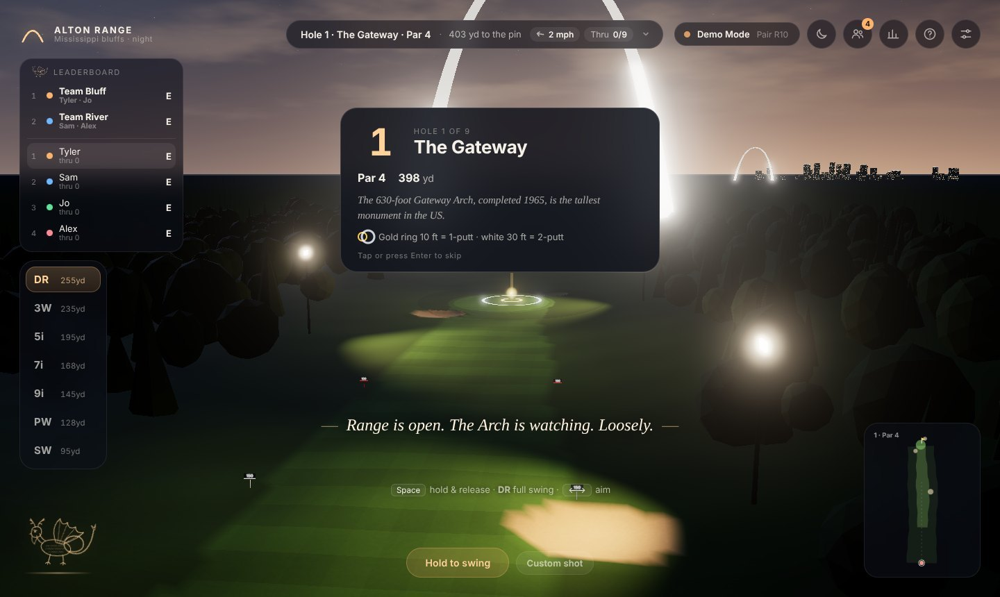
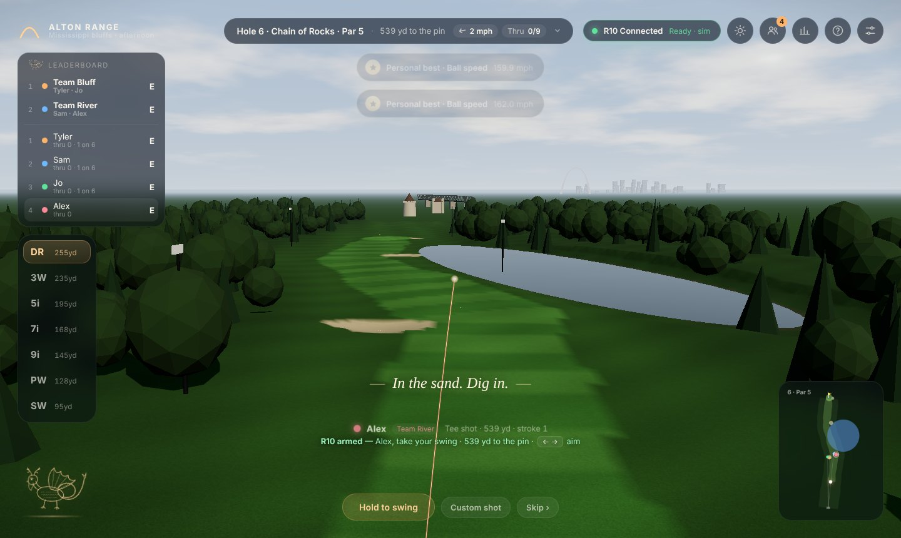
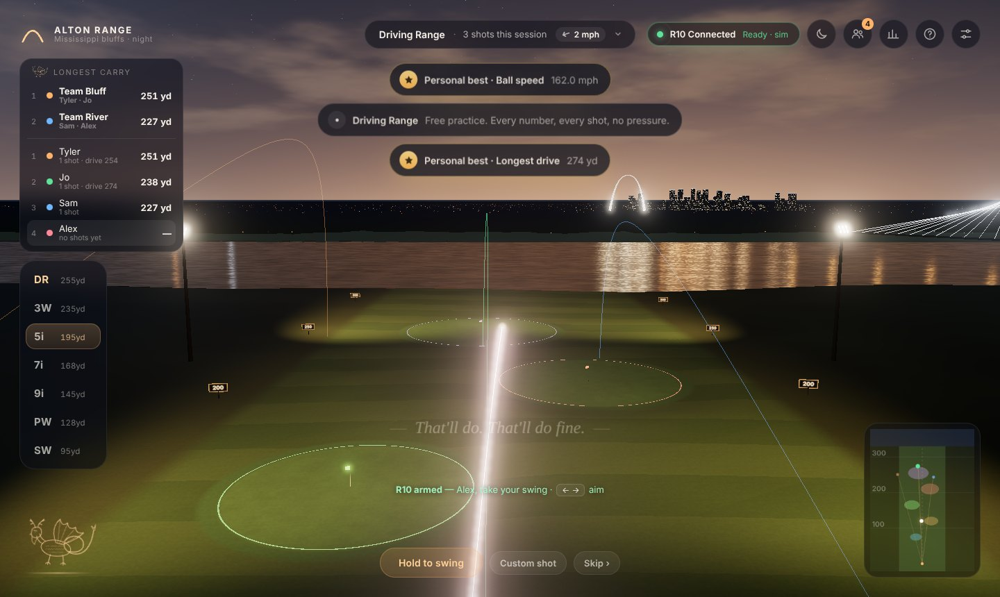
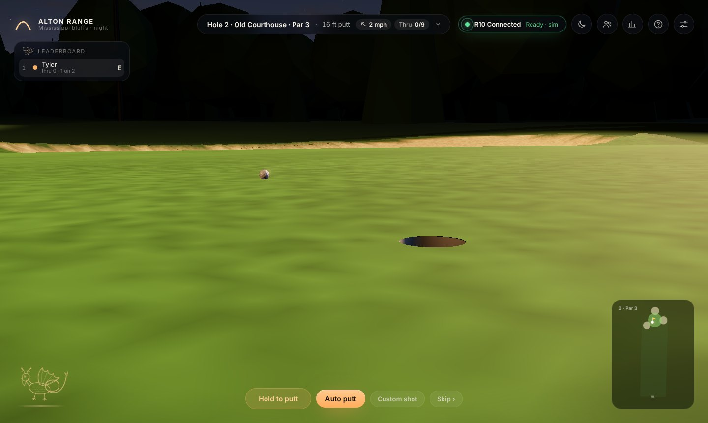
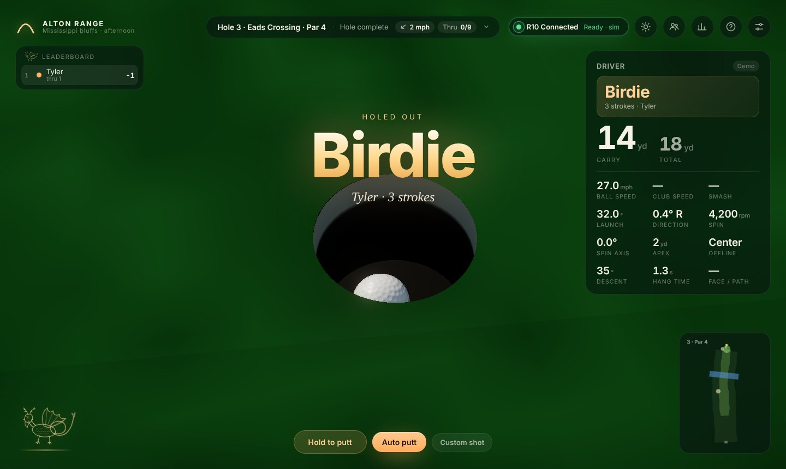
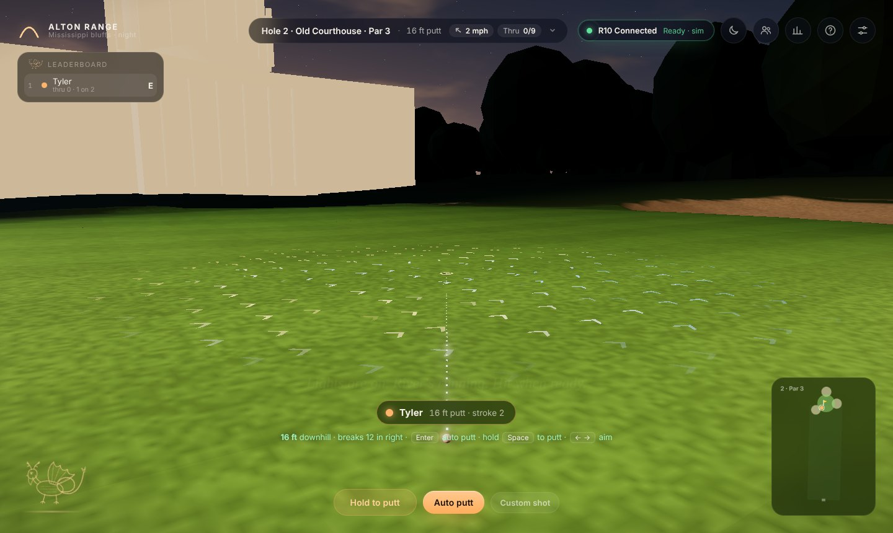
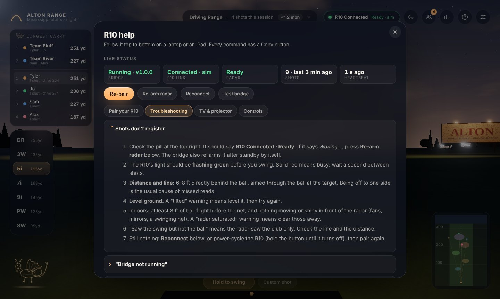

# Alton Range

Golf on the bluffs above the Mississippi, in the browser. A night (or
afternoon) driving range with the Gateway Arch on the horizon, an 18-hole
course built around St. Louis and Alton landmarks, up to six players with
teams, and every swing from a **Garmin Approach R10** landing live with a
glowing tracer, a cinematic camera and the full set of numbers.


| | |
|---|---|
|  |  |
|  |  |
|  |  |
|  |  |

## Quick start

**Open the game (with or without an R10):**

```bash
cd bridge
pip install -r requirements.txt     # first time only (Python 3.10+)
python -m r10bridge --open          # serves the game at http://localhost:8765
```

Open **<http://localhost:8765>**, then press **Pair Garmin R10**, or **Play in
Demo Mode**. No R10 handy? `python -m r10bridge --mock --open` runs a simulated
R10 through the full Bluetooth protocol stack.

| You want | Run on the computer | Open |
|---|---|---|
| Play on this computer | `python -m r10bridge` | `http://localhost:8765` |
| Play on a TV or projector from the computer | `python -m r10bridge` | `http://localhost:8765/?tv` |
| Use an iPad as the screen | `python -m r10bridge --lan` | `http://<computer-name>.local:8765/?tv` on the iPad (the bridge prints the exact address) |
| Check the Bluetooth setup step by step | `python -m r10bridge --diagnose` | — |
| Rehearse without hardware | `python -m r10bridge --mock` | `http://localhost:8765` |

**Demo mode only (no Python needed):** serve the folder with any static server.
ES modules don't load from `file://`.

```bash
python -m http.server 8000          # then open http://localhost:8000
```

Requires a WebGL 2 browser: current Chrome, Edge, Safari or Firefox.

## Running the bridge alongside the game

Browsers can't talk to the R10 directly, so a small Python bridge does it:

```
 Garmin R10 ──BLE──▶ r10bridge (Python, bleak) ──WebSocket JSON──▶ game (browser)
                     ws://localhost:8765            same port serves the game over HTTP
```

1. **Install once:** `cd bridge && pip install -r requirements.txt` (Python 3.10+).
2. **Start it:** `python -m r10bridge`. Leave the terminal open while you play.
3. **Pairing mode:** turn the R10 on and hold its button until the LED is
   **solid blue**. Close the Garmin Golf app; the R10 talks to one device at a time.
4. **Open the game** at <http://localhost:8765> and press **Pair Garmin R10**.
   You'll see the scan, then pairing, then the radar arming, then a check.
   The **R10 Connected** pill stays top-right and shows the radar state
   (Ready / Recording / Processing).
5. **Place the R10** 1.8–2.4 m (6–8 ft) behind the ball, level, with the red
   alignment line on your target (Garmin's guidance). You can set the exact
   distance in *Settings → R10 to ball*.

If the bridge isn't running, the game says so and shows the commands to copy.
If the R10 isn't found or pairing fails, you get specific fixes, plus a way
straight into demo mode. If the link drops mid-session, the bridge reconnects
on its own and the game keeps playing in demo mode until it's back.

Press **?** (or the help button, top right) in the game at any time for the
**R10 help** panel. It shows live bridge status (heartbeat, radar state, shot
count), has **Re-arm radar**, **Reconnect** and **Test bridge** buttons, and
walks through pairing, troubleshooting ("shots don't register", "no R10
found", macOS/iPad issues) and TV setup. It's written to follow on an iPad or
a MacBook.

**Reliability.** The bridge retries transient Bluetooth errors, re-sends the
handshake if the R10 is slow to arm, reconnects without limit if the link
drops, re-arms the radar when it falls into standby, and sends a heartbeat
every 5 seconds. The game treats a silent bridge (a sleeping laptop) as lost
and reconnects. Shots are de-duplicated by the R10's shot ID, and a swing the
radar saw without the ball shows a "check alignment" toast instead of
vanishing. A rotating log goes to `~/.r10bridge/bridge.log`.

On a Mac that might sleep mid-round: `caffeinate -dims python -m r10bridge`.

OS notes, CLI options and the WebSocket message format are in
[`bridge/README.md`](bridge/README.md).

## Big screen: TV, projector, iPad

TV mode scales the whole interface for couch distance (3–4 m) and thickens
the tracer and ball. Turn it on with `?tv` in the address or *Settings → Screen*.

- **MacBook → TV (recommended).** Connect HDMI / USB-C, or AirPlay
  (*Control Center → Screen Mirroring*). Use the TV as a separate display so
  the terminal stays on the laptop. Run `python -m r10bridge`, open
  `http://localhost:8765/?tv` on the TV display, and go full screen (⌃⌘F).
- **iPad → TV.** iPadOS can't run the bridge, so run it on a Mac or PC with
  `python -m r10bridge --lan`. It prints the address to open on the iPad, e.g.
  `http://your-mac.local:8765/?tv`. In Safari use *Share → Add to Home Screen*
  for a full-screen app, then mirror the iPad to an Apple TV or through a
  USB-C / Lightning HDMI adapter. The game keeps the screen awake while you play.
- **Projector.** Same as the MacBook setup. Afternoon conditions read better
  in a bright room; turn the lights down for the night range.

`--lan` lets other devices on your network open the game and connect to the
bridge. Use it on your home Wi-Fi, not on a network you don't trust.

## Playing

| Input | Action |
|---|---|
| **Swing with the R10** | Every swing is a shot for whoever's turn it is |
| **Hold Space / hold the Swing button** | Demo swing: release in the green zone (84–98%) for a pure strike; soft swings stay clean, over-swings get wild |
| **← →** | Aim (also rotates R10 shots, like any simulator's target line); finer on the green; **R** resets |
| **1–7** or **↑ ↓** | Club (the course picks one for you each shot) |
| **Enter** | On the green: auto putt. Otherwise: skip to the result |
| **M** / **P** / **S** | Choose a game / players & teams / scorecard |
| **N** | Day ↔ night |
| **C** | Camera: Cinematic → Follow → Tee |
| **Tab** | Session stats and personal bests |
| **H** or **?** | R10 help |
| **G** | Green slope arrows on/off |
| **Custom shot** | Type in launch numbers from any monitor |

### Games

- **The Confluence Course.** Front 9, back 9, or all 18 (par 70). Each hole
  is themed on a landmark: the Gateway Arch, the Old Courthouse, Eads Bridge,
  the Alton riverfront, the Piasa bluff, Chain of Rocks Bridge and its bend,
  Monks Mound at Cahokia, the Cathedral Basilica, a riverboat, Union Station,
  the Climatron, the Grand Avenue Water Tower, the confluence of the Missouri
  and Mississippi, Mel Price Locks & Dam, the World's Fair Pavilion, the Jewel
  Box, Robert Wadlow (the Alton giant), and the Arch again to finish. Holes
  have elevation, doglegs, sloped greens, bunkers, creeks, ponds and an island
  green. Each hole opens with a fly-over and a hole card. Rules: rough and sand
  cost distance and spin, water is a one-stroke drop, out of bounds is stroke
  and distance, gimmes (off / 2 ft / 4 ft), and a pick-up at par + 4 keeps a
  six-ball moving. **Putting:** press Enter for an auto putt (Tour make
  percentages by distance, rolled for real on the slope), or hold Space to
  putt yourself with the read shown on screen. The round saves after every
  hole and resumes after a reload.
- **Driving Range.** Free practice with ghost tracers, a dispersion mini-map
  and five lit target greens.
- **Closest to Pin.** Five holes at varied distances (wedges, mixed or long),
  wind per hole, and proximity scoring (100 points × e^(−metres/6); 250 for an ace).
- **Target Practice.** Three targets, three balls each: bullseye 50, inner 30,
  on target 15, near miss 5.
- **Longest Drive.** Balls into a 50-yard grid, best ball counts. The bluff
  edge sits at about 330 yards, so a big enough drive finds the Mississippi.

### The hole

The cup is a real hole: 4¼ in across and 4 in deep, cut through the turf with
a white-topped liner you can see into. The ball physically rolls in. It drops
when it stays over the hole long enough to fall one ball radius before
reaching the far edge. That works out to about 1.6 m/s dead centre (the
measured figure for real cups) and less off-centre. Anything firmer or wider
catches the lip and spins out. Chips can roll in or dunk, and they rattle off
the flagstick when it's in. Putts are struck with the flagstick out.

When a ball is going in, the camera cuts to cup level on the far side of the
hole, play drops into slow motion, and the camera pushes in as the ball tips
over the edge. You hear the rattle off the liner and the hollow knock on the
bottom. Then a banner (Birdie, Par, Hole in one…), gold sparks out of the cup
and the gallery, scaled to how good it was. The camera then rises over the
cup so you see the ball sitting in the bottom.

Greens are built at high detail around the hole, with tilt plus swells and
swales. Pins sit on calmer ground, and peak slopes are 3–4%. Mowing stripes
and slope shading show the contours from the fairway. On the green:

- Animated arrows flow downhill over the last ~15 ft to the cup, coloured
  blue (gentle), gold (medium) or red (steep), and fade out toward the edge.
  Press **G** to hide them.
- A dotted aim line runs to the hole, and the read shows length, uphill or
  downhill, break, and "plays like" distance.
- The gold mark on the putting meter is the pace for this putt, slope included.
- A gimme is tapped in for you, so every hole still finishes in the cup.

The ball itself has ~330 modelled dimples and a clear-coat finish for close-ups.

### Players and teams

One to six players share one R10. The game says whose turn it is before each
swing, colours the tracer per player, and keeps a live leaderboard. On the
course, everyone tees off in honour order and then the player farthest from the
hole plays, with name tags over everyone's ball. Turn on **teams** for 2 v 2,
3 v 3, 2 v 2 v 2 or any custom split: the course plays best ball, and the range
games add up team totals. Names and colours are remembered.

### Conditions

The sun/moon button switches **Night ↔ Afternoon** with a smooth transition and
sets the weather: **Clear, Cloudy, Light wind (~8 mph, gusty), Strong wind
(~20 mph, gusty)**. Wind moves the ball in every mode, shows in the HUD as an
arrow relative to your target, and turns with each hole on the course.

### The Piasa

The Piasa, the creature Marquette and Jolliet recorded painted on the bluffs
near Alton in 1673, perches in the corner of the screen. It beats its wings at
birdies, eagles and big drives, winces at water, and otherwise leaves you alone.
Tap it for a line of history. It's also painted on the cliff behind hole 5. The
artwork is original; to use your own Piasa image, set `ASSET_MANIFEST.piasa.url`
in `js/scene/assets.js`.

Personal bests (longest drive, top ball speed, carry by club, closest to pin,
best rounds, best 9 and 18) persist in the browser. Sessions export to CSV with
the player name on every shot.

## Ball physics

Ball flight is integrated with RK4 at 240 Hz: gravity, drag and Magnus lift
driven by the spin factor *S = rω/v*, spin decay, a drag rise at low Reynolds
number, and wind. Coefficients were fitted to Trackman's published PGA Tour
averages (`node tools/calibrate.mjs` prints the check):

| Club | Ball / launch / spin | Model carry | Tour carry |
|---|---|---|---|
| Driver | 171 mph · 10.4° · 2545 rpm | 271 yd | 282 yd |
| 7-iron | 123 mph · 16.3° · 7124 rpm | 178 yd | 176 yd |
| PW | 102 mph · 24.2° · 9304 rpm | 134 yd | 136 yd |

Every club is within 4% on carry and close on apex and descent angle.
Landing uses spin-aware bounce (wedges check up, drivers release about 20 yd)
and surface-specific roll on fairway, rough and green. A ball can run off the
bluff and fall into the river. The whole flight is simulated the moment a shot
arrives, so the camera and commentary know the outcome before the ball lands.

## Project layout

```
index.html, css/app.css      UI shell and styling (no build step)
js/main.js                   boot + frame loop
js/core/                     physics, units, event bus
js/scene/                    renderer, sky, terrain, river shader, skyline (Arch, bridge,
                             barges, riverboat), range props, ball, tracer, effects, camera,
                             asset slots (glTF / characters)
js/game/                     game controller, range modes, course mode, roster, commentary
js/course/                   hole data, analytic hole terrain, landmarks, course scene
js/net/bridgeClient.js       WebSocket client for the bridge
js/ui/                       pairing flow, HUD, panels (help, players, scorecard), Piasa
js/audio/audio.js            procedural WebAudio sound (impacts, flight, splash, ambience, UI)
js/data/                     clubs, session store, personal bests
bridge/                      Python R10 bridge (port of 10over) + tests
vendor/three/                three.js r186, vendored so the game works offline
tools/calibrate.mjs          physics calibration check
tools/holes-check.mjs        course sanity check (tees, greens, hazards, par)
```

## Adding Blender / glTF assets and scanned characters

`js/scene/assets.js` holds an `ASSET_MANIFEST` with a slot for each element
that might later be authored: `golfer`, `arch`, `bridge`, `riverboat`, `canopy`
and `sign`. A slot with `url: null` keeps the procedural version. Point a slot
at a `.glb` (exported from Blender at metre scale, +Y up, origin at the base)
and it loads with the transform in the manifest.

The `golfer` slot takes a rigged, scanned character. Include an animation clip
named `swing` (and optionally `idle`). Launch data arrives just after impact,
so on every shot the game plays the clip from its impact point
(`IMPACT_FRACTION` in `assets.js`) through the follow-through. Put models under
`assets/` and they're served by the bridge and by any static server.

The scene modules are split by feature (`skyline.js`, `rangeProps.js`, …), so
swapping a procedural group for an imported one stays local to one file.

## Tests

```bash
cd bridge && python -m pytest       # protocol, handshake, WebSocket, static serving
node tools/calibrate.mjs            # physics vs Trackman tour averages
```

## Credits

- R10 protocol: [divotmaker/10over](https://github.com/divotmaker/10over) (MIT OR Apache-2.0); this repo's bridge is a Python port.
- 3D: [three.js](https://threejs.org) (MIT), vendored in `vendor/three`.
- Gateway Arch geometry: the National Park Service catenary formula.
- Reference numbers: Trackman PGA Tour averages; Garmin Approach R10 Quick Start Manual (placement and pairing).

Not affiliated with Garmin, Trackman, the National Park Service or the City of Alton.
